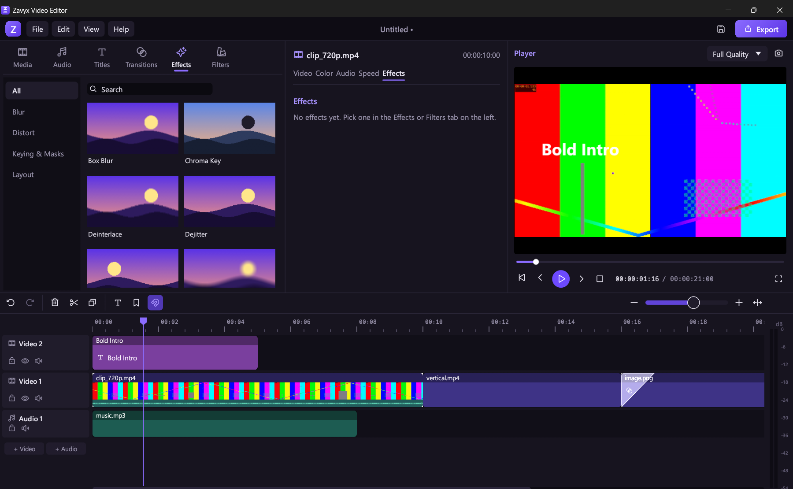

<p align="center">
  
</p>

<h1 align="center">Zavyx Video Editor</h1>

<p align="center"><sub>Zavyx VE · part of the <a href="https://github.com/mohammadibrahimdev/zavyx">Zavyx</a> family of free tools</sub></p>

<p align="center">
  <b>Free video editor for Windows — 64-bit and 32-bit.</b><br>
  Timeline editing · titles · transitions · effects & filters · export to MP4 · no watermark, no account, no tracking.
</p>

<p align="center">
  <a href="https://github.com/mohammadibrahimdev/zavyx-video-editor/releases/latest"></a>
  <a href="LICENSE-MIT"></a>
  
</p>

<p align="center">
  
</p>

---

## ✨ Features

- **Start fast** — pick 16:9 (YouTube), 9:16 (Shorts, Reels, TikTok), 1:1, 4:5 or 21:9 and start a project; recent projects are one click away.
- **Import anything** — videos, music and photos (MP4, MOV, MKV, AVI, WEBM, MP3, WAV, PNG, JPG…). Drag files straight onto the window.
- **Multi-track timeline** — thumbnails and waveforms, drag to move, drag edges to trim, snapping, split (Ctrl+B), ripple delete, copy/paste, markers, lock/hide/mute tracks, unlimited undo.
- **Smooth preview** — real-time playback with sound, frame stepping, full-screen preview, audio meter.
- **Titles** — 20 templates; edit the text, font, size, colour, alignment, shadow, outline and background.
- **30 transitions** — dissolve, dips, wipes, slides, pushes, shapes, zoom, spin, glitch and more.
- **40+ effects & filters** — blur, mirror, shake, glow, VHS, old film, sepia, duotone, chroma key (green screen), masks, picture-in-picture…
- **Colour & motion** — exposure, contrast, saturation, temperature and more; scale, position and opacity with keyframe animation.
- **Audio** — volume, fade in/out, per-clip speed (pitch kept) and reverse.
- **Export** — MP4, MOV, MKV, WEBM, GIF, MP3 or WAV, up to 4K, choose frame rate and quality. Snapshot any frame as PNG.
- **Private** — works offline, autosaves your work, no watermark, no limits, no telemetry.

## ⬇ Download & install

1. Go to the **[latest release](https://github.com/mohammadibrahimdev/zavyx-video-editor/releases/latest)**.
2. Download **`ZavyxVE-Setup-x.y.z-x64.exe`** (or **`-x86.exe`** for 32-bit Windows builds) and run it. No admin rights needed.

Prefer no installer? Download the **portable ZIP**, unzip it anywhere and run `ZavyxVE.exe`.

> Windows SmartScreen may warn about a new app from an unknown publisher. Click **More info → Run anyway**.

> **32-bit build:** it runs on older PCs with 64-bit Windows as-is. On a 32-bit-only Windows, replace the bundled `ffmpeg.exe` with a 32-bit build.

## ⌨ Shortcuts

| Key | Action | Key | Action |
| --- | --- | --- | --- |
| Space | Play / pause | Ctrl+B | Split at playhead |
| ← / → | Previous / next frame | Del / Shift+Del | Delete / ripple delete |
| Home / End | Start / end | Ctrl+C / V / D | Copy / paste / duplicate |
| Ctrl+Z / Y | Undo / redo | M | Add marker |
| Ctrl+I | Import media | Ctrl+E | Export |
| Ctrl+S | Save project | Ctrl + wheel | Zoom the timeline |

## 🛠 Build from source

Requirements: [Rust](https://rustup.rs) (stable) on Windows, and `ffmpeg.exe` in a `bin\` folder at the repo root (for example the [gyan.dev essentials build](https://www.gyan.dev/ffmpeg/builds/)).

```bash
git clone https://github.com/mohammadibrahimdev/zavyx-video-editor.git
cd zavyx-video-editor
cargo build --release
cargo test --workspace
```

The app is `target\release\ZavyxVE.exe`; for the 32-bit build add `--target i686-pc-windows-msvc`. To build the installers and portable ZIPs like the official release (downloads ffmpeg if needed; needs [Inno Setup 6](https://jrsoftware.org/isinfo.php) for the installers):

```bash
powershell -ExecutionPolicy Bypass -File scripts\package.ps1
```

Projects can also be rendered from the command line:

```bash
zavyx-ve-cli render my-project.zvep -o video.mp4 --height 1080 --quality high
```

### Project layout

| Folder | What it is |
| --- | --- |
| `crates/zavyx-ve-gui` | The desktop app (`ZavyxVE.exe`), built with egui |
| `crates/zavyx-ve-core` | Project model, timeline, keyframes, undo/redo, `.zvep` files |
| `crates/zavyx-ve-media` | Reading media through ffmpeg (probe, decode, audio, waveforms) |
| `crates/zavyx-ve-render` | Compositor, effects, transitions, titles, audio mixer and export |
| `crates/zavyx-ve-audio`, `zavyx-ve-ai` | Audio DSP helpers and optional local-AI building blocks |
| `crates/zavyx-ve-cli` | Command-line renderer (`zavyx-ve-cli.exe`) |
| `installer/` | Inno Setup installer script |

### Releasing a new version (maintainers)

```bash
powershell -ExecutionPolicy Bypass -File scripts\release.ps1 0.2.0
```

This updates the version, runs the tests, tags `v0.2.0` and pushes. GitHub Actions then builds both installers and publishes the release automatically.

## 🤝 Contributing

Bug reports, ideas and pull requests are welcome — please open an [issue](https://github.com/mohammadibrahimdev/zavyx-video-editor/issues).

## 👤 Author

Made by **Mohammad Ibrahim** — [github.com/mohammadibrahimdev](https://github.com/mohammadibrahimdev)

Zavyx VE is part of **[Zavyx](https://github.com/mohammadibrahimdev/zavyx)** — a family of free tools.

## 📄 License

Free and open source under the [MIT](LICENSE-MIT) or [Apache-2.0](LICENSE-APACHE) license, at your option. © 2026 Mohammad Ibrahim.

The Zavyx name and logo are not covered by the licence: a modified version must use its own name and icon.

The bundled FFmpeg keeps its own licence — see [THIRD-PARTY-NOTICES.md](THIRD-PARTY-NOTICES.md).

Zavyx VE is an independent project and is not affiliated with any other video editor.
